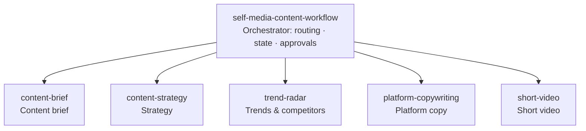

# Self Media Skills (English edition)

[](https://github.com/upiznhec/self-media-content-workflow/actions/workflows/validate.yml)
[](LICENSE)
[](CHANGELOG.md)

A modular, tool-agnostic suite of agent skills for social-media content work: from a vague idea to a confirmed brief, account strategy, trend and competitor research, platform-native copy and short-video packages, with optional digital-human and animated-explainer production.

This is an English edition of [self-media-content-workflow](https://github.com/yanhua1010/self-media-content-workflow) by [Yanhua](https://github.com/yanhua1010). The method is the original's; the text is translated, and the parts listed under [What changed in this edition](#what-changed-in-this-edition) were removed, adapted or changed.

- **Tool-agnostic**: no binding to a specific model, browser, image, video or research service; capabilities are discovered from the running environment
- **Platform-native**: one topic shares facts and evidence, while titles, openings, structure and calls to action are designed per platform
- **Human-in-the-loop**: five approval gates (direction, platforms, title and hook, final copy, and any external write action); the skills deliver drafts and publishing packs, and you publish
- **Evidence-first**: every key number needs a source; facts, opinions, inferences and advice stay separated; no invented data, experience or results
- **Systematic visuals**: eight built-in image-style presets with platform routing; a style is chosen before generation, one style per image set, and account preferences override preset defaults

For digital-human production, the user must personally upload and select likeness and voice assets in the chosen provider after reviewing its current data-processing terms. Task files, registries and the repository must not store the original portrait or recording, their local paths, temporary links or provider-private identifiers; they only index paths of deliverables such as generated clips, final videos and caption files.

## Architecture



| Skill | Responsibility |
|---|---|
| [`self-media-content-workflow`](skills/self-media-content-workflow/SKILL.md) | Request routing, state management, approvals, the evidence pack, quality gates and end-to-end orchestration |
| [`self-media-content-brief`](skills/self-media-content-brief/SKILL.md) | Audience, goal, evidence, angle, tone and constraints |
| [`self-media-content-strategy`](skills/self-media-content-strategy/SKILL.md) | Positioning, content mix, series, topic pool and calendar |
| [`self-media-trend-radar`](skills/self-media-trend-radar/SKILL.md) | Trend tracking, keyword research, competitor teardowns and original topics, with optional Reddit discussion discovery |
| [`self-media-platform-copywriting`](skills/self-media-platform-copywriting/SKILL.md) | Native copy for X, Xiaohongshu, Reddit, WeChat, short-video platforms and YouTube, plus the visual style library |
| [`self-media-short-video`](skills/self-media-short-video/SKILL.md) | Hooks, spoken script, storyboard, subtitles, shooting plan, optional digital-human and animated-explainer production, and landscape and vertical platform versions |

The trend radar's [Reddit discussion discovery](skills/self-media-trend-radar/references/reddit-discovery.md) can optionally read public Reddit data through the [AIsa](https://go.aisa.one/yanhua) REST API. Each request costs about $0.0019, and every run is quoted to you before it starts. Without a key, the same steps are done in a browser.

> Disclosure: the AIsa link above is the original author's referral link. If you sign up and pay through it, the original author, Yanhua, earns a commission at no extra cost to you.

## Platforms

Guidance is included for X, Reddit, YouTube, Xiaohongshu, WeChat Official Accounts, WeChat Channels and Douyin.

- Instagram and Facebook: no guidance yet. If you need them, follow the Xiaohongshu method.
- TikTok: no separate guide; use `self-media-short-video`.
- LinkedIn: not covered.

## Quick start

### Install

**Claude Code (recommended, no Node.js required)**

Run these two commands inside Claude Code to install all 6 skills at once:

```text
/plugin marketplace add upiznhec/self-media-content-workflow
```

```text
/plugin install self-media-suite@self-media
```

**Other agents (Codex, Cursor and more)**

Use the official [skills CLI](https://github.com/vercel-labs/skills) (requires Node.js):

```bash
# Install all 6 skills into the current project
npx skills add upiznhec/self-media-content-workflow

# Install into the user-global skill directory
npx skills add upiznhec/self-media-content-workflow -g
```

Install a subset with `--skill <name>`, and target specific agents with `-a`:

```bash
npx skills add upiznhec/self-media-content-workflow --skill self-media-content-workflow -a claude-code
```

### First task

Start from the orchestrator; it routes to the modules it needs:

```text
Use $self-media-content-workflow to turn this product-failure story into an X thread and a Xiaohongshu carousel.
```

Modules can also be invoked directly:

```text
Use $self-media-content-strategy to build a topic pool and a one-month calendar for a new account.

Use $self-media-trend-radar to research the most-asked questions about AI coding content in the last month.

Use $self-media-short-video to turn this approved topic into a 60-second spoken script with three hooks and a storyboard.
```

> The exact skill-invocation syntax depends on your agent.

## Workflow

```text
Clarify → Direction approval* → Research & evidence → Platform approval* → Preflight
→ Title and hook approval* → Platform-native draft → Assets (live-action / digital human / animation) → Quality gates
→ Final-copy approval* → Publishing pack
```

`*` marks a mandatory human approval gate. Any external write action needs its own approval as well. Final-copy approval is not permission to publish: the skills deliver a publishing pack for each platform, and you publish.

Before assets are generated, the workflow recommends 2 to 3 styles from the [visual style library](skills/self-media-platform-copywriting/references/visual-styles.md) based on content type and platform, or reuses the account's established preference.

## Safety boundaries

- No automated competitor scraping with a creator's primary account session
- No automatic likes, comments, follows, DMs or publishing
- No cookies, tokens or secrets in task cards, logs or the repository
- Digital-human portraits, likenesses and voices must have confirmed usage rights; the user personally uploads and selects them in the chosen provider after reviewing its current data-processing terms
- No original portraits or recordings, their local paths, temporary links or digital-human provider-private identifiers in task cards, content registries or the repository; only index paths of deliverables such as generated clips, final videos and captions; confirm the required AI or digital-human disclosures per target platform
- Stop immediately on CAPTCHAs, rate limits or platform risk controls
- Verify recent products, prices, versions and platform rules against official sources
- Never invent data, experience, revenue, user feedback or test results

See [SECURITY.md](SECURITY.md) for the full policy.

## Validation

```bash
python3 scripts/validate.py
```

The validator checks skill frontmatter, directory consistency, core-file length, UI metadata, relative links and unresolved TODOs, with no third-party dependencies. CI runs the validation on every push and performs a real installation test with the official skills CLI.

## Repository layout

```text
skills/                   # 6 independently installable skills
├── <skill>/SKILL.md      #   core workflow (≤ 500 lines)
├── <skill>/references/   #   detailed platform guidance
└── <skill>/assets/       #   copyable output templates
scripts/validate.py       # repository validation
.claude-plugin/           # Claude Code plugin and marketplace manifests
.github/workflows/        # structural validation + install test
```

## Design decisions

- One orchestrator owns routing and state; five modules each own a single responsibility
- Research and generation tools are runtime adapters, never vendor-bound
- Platforms share facts and evidence, while titles, openings, structure and actions are rewritten per platform
- Platform limits change; exact values defer to official documentation or the publishing interface

## What changed in this edition

- Translated into English, keeping the meaning.
- Kept: the orchestrator (trimmed to the kept modules), content brief, content strategy, trend radar (research process and Reddit discussion discovery), platform copywriting and short video.
- Removed: content analytics, content delivery, the WeChat publisher, the video publisher, the workbench app, and the trend radar's overseas comparison mode and its scripts. The workflow ends with a publishing pack, and you publish.
- Rules that counted Chinese characters were rewritten by what they are for. For example, "at most 14 characters per line" became "short enough to read as one line on a phone", and narration length is estimated at about 150 words a minute, the usual speaking rate in English. Details that only applied to Chinese text or Chinese-speaking viewers were removed.
- Rules about Chinese platforms and Chinese law (for example, China's rules on labeling AI-generated content) are kept for the platforms that are kept.
- Changed one step: you choose the title (and, for video, the hook) before the first draft is written. The original writes the complete first draft first and then waits for your choice of title.

See [CHANGELOG.md](CHANGELOG.md) for details.

## Credits

- Original work: [self-media-content-workflow](https://github.com/yanhua1010/self-media-content-workflow) by [Yanhua](https://github.com/yanhua1010), released under the MIT License (Copyright (c) 2026 Yanhua). The original repository is in Chinese and includes the modules this edition removed.
- English edition: [upiznhec](https://github.com/upiznhec), under the same license.

## Contributing

Issues and pull requests are welcome. Read [CONTRIBUTING.md](CONTRIBUTING.md) and run `python3 scripts/validate.py` before submitting. Changes that also apply to the original are better proposed in [the original repository](https://github.com/yanhua1010/self-media-content-workflow).

## Disclaimer

This project is a content-creation assistance Skill suite, provided "as is" without warranty of any kind, express or implied. Before using it:

- **Official platform rules prevail.** Platform conventions and operational advice in this repository reflect experience at the time of writing, and platform rules can change at any time. When an exact value matters, defer to official announcements and the current publishing interface.
- **Account use is at your own risk.** You publish on your own accounts, and any research or generation services you connect run under your accounts and their terms. The authors are not liable for rate limiting, account suspension, content removal, data loss or any other damages arising from use of this project.
- **You control your own credentials.** This project does not collect, transmit or store credentials. Keys such as `AISA_API_KEY` are supplied only through your local environment variables; never write them into any file that could be committed or shared.
- **Content compliance is the publisher's responsibility.** The compliance checklists here are not legal advice. Whether your published content complies with applicable advertising and content laws, and with each platform's community guidelines, is yours to judge and to answer for.
- **No results are guaranteed.** This project makes no promise regarding reach, follower growth, conversion or revenue.

## License

[MIT](LICENSE)
